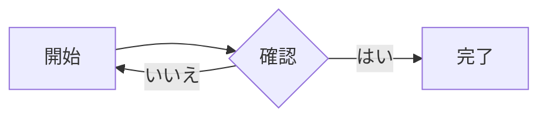
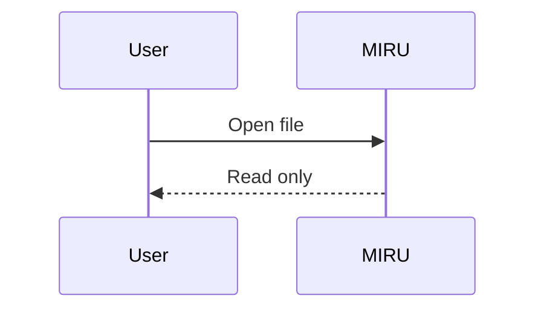
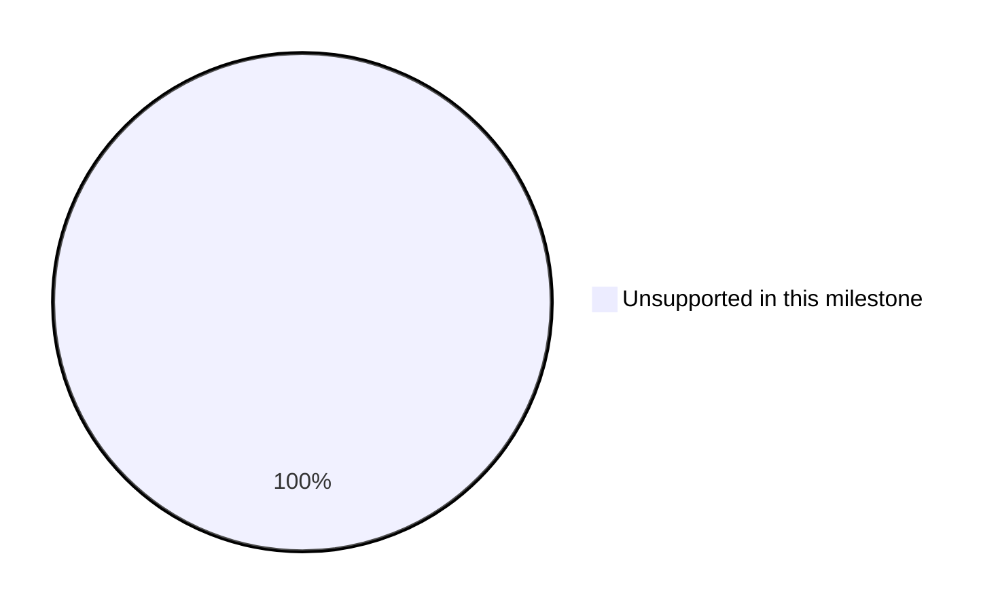

# MIRU native smoke · 日本語

**Bold**, _italic_, ~~struck~~ and `read-only code` remain text. Source should retain this whole file.

- [x] Static task state
- [ ] Real Windows GUI acceptance remains pending

| View       | Expected                       |
| ---------- | ------------------------------ |
| Files      | Local text and native Markdown |
| Repository | Bounded read-only comparison   |

## Flowchart

## Sequence

## Expected source fallback

## Inactive content

[This is text, not an active link](https://example.invalid/miru-smoke)

<strong>HTML stays literal text, not active UI.</strong>
